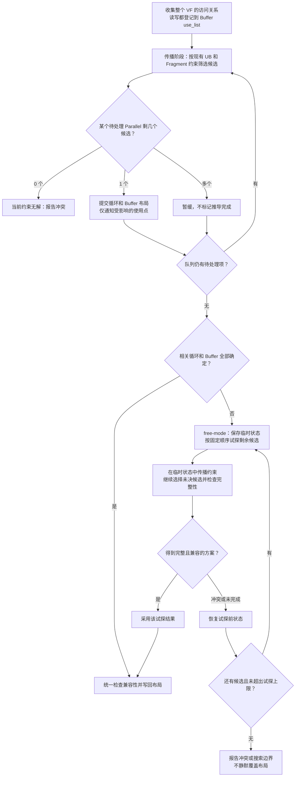

# PR-4 Fragment 存储详细设计评审

## 1. 依据与结论

- 原方案：[TileLang Parallel 到 PTO：目标设计方案](https://hw-native-sys.feishu.cn/docx/Nd6jdRPp2oLXtoxmhXBcUaRpnOh)，revision 130。重点对照 §3、§4.5～4.6、§5、§6、§8.6、§9、§10。
- 实现稿：[PR4 Fragment-slot 存储详细设计](<../TileLang Parallel 到 PTO：PR4 Fragment-slot 存储详细设计.md>)，评审版本共 488 行。
- 源码按实现稿声明的 `977425df2c6ab67b710a2de6884651db7d8a2f74` 核对，TVM 按该提交的 gitlink `4211874e9e4b8770fd20ad0d98ab80afd1df5028` 核对，不以本地当前 TVM 代替。
- 本文是方案与源码静态评审，未实施编译器修复，也未执行设备测试。下文反例按拟议转换规则推导，不代表已经运行过的失败测试。

预留 UB、单份 backing 和现有地址分配架构可以沿用。接口使用 TIR 的 `declare_fragment_buffer` 和通用 `vload/vstore`，codegen 输出 `pto.memref_declare` 及普通 PTO VMI 访存。实施前还要明确容量核算、布局候选、masked 写回和 region 转换。公共代码只改必要接入点，不重构通用同步或 TVM Buffer。

## 2. backing、plan 与 Fragment 存储句柄

backing 是为 Fragment Buffer 预留的普通 UB Buffer。按原方案 §6.1，用标准 SBlock 分配表达：

```python
x_fragment_backing = T.sblock_alloc_buffer(
    (32 * 128,), "float32", scope="shared.dyn"
)
```

| 对象 | 含义 |
|---|---|
| x_fragment_backing | UB 预留 Buffer，记录在 SBlock.alloc_buffers，最终参加地址分配 |
| PtoSlotPlan | Fragment→backing、count、vector type、alignment、bytes、预建 fragment_mem_var 的记录，挂在 SBlock 注解中 |
| x_frag_mem | Vectorize 在 vecscope 内用 Bind 定义的逻辑句柄，后续 vload/vstore 以它为基址 |

C++ pass 创建普通 shared.dyn Buffer 并追加到 SBlock.alloc_buffers，打印后就对应上述 TIR；不需要调用 Python builder，也不需要修改公共 Buffer 类型。Plan 预建 fragment_mem_var 只创建 Var 对象，在 IR 中定义该值的 Bind 仍由 Vectorize 生成。

pass 顺序如下：

```text
LayoutInference / 前置 Buffer 处理
→ PlanPtoSlotStorage：增加 backing 分配和 plan，预建 fragment_mem_var，但不发射 Bind
→ AutoSchedule / 普通 UB 多缓冲链（启用时）：容量扣减一次，Fragment 存储单份
→ NormalizeBufferVersion
→ VerifyParallelToPTO → LegalizeParallelToPTO
→ VectorizeParallelToPTO：Bind(fragment_mem_var, declare_fragment_buffer(backing_ptr, count, lanes))
                         转换 Fragment 读写，消费对应 plan 和原 Fragment 分配
→ AscendLowerTileOp：处理剩余 tile op
→ LowerAccessPtr → LowerOpaqueBlock → RewriteAscendBufferVersionLayout
→ FlattenBuffer / 其他既有 lowering / SplitHostDevice
→ InferBufferAliases（关闭 AutoSchedule 时）
→ MergeUBAllocations：独占地址与最终容量
→ PTO codegen → PTOAS
```

PtoSlotPlan 不必一直传到 Merge。Vectorize 消费它之后，declare_fragment_buffer 已携带有类型的 backing 地址、count 和 lanes；后置 pass 继续重写真实地址操作数。晚期分配器需要识别 backing，但不能要求已经消费的 plan 继续存在。

原方案 §6.5 规定完整 VF 顺序执行，Fragment backing 只保留一份，可以与普通 UB 双缓冲共存。基线将整个 SIMD_VF SBlock 作为一个 task，而不是把其中的 Parallel 拆开调度：`materialize_schedule_units.cc:69–73,136–139` 负责构造 task，`scheduled_tir.cc:282–295` 保存其 body 并分析访问。外层流水中完整 VF 的重复执行需要回归测试，不需要新增 Fragment 存储顺序协议，也不需要禁止外层流水。

PTOAS 在寄存器驻留和访问已绑定 backing 之间选择，不重新预留或分配 UB。重算属于原方案 §10.2 的后续方向，不属于 PR-4 的交付要求。

## 3. 评审意见与修复方案

P1 表示按实现稿直接实施可能导致错误写回、漏算容量或无法完成主要编译路径；P2 表示需要明确的接口、兼容性规则或集成验收要求。

下文的 TIR 结构和转换结果都是方案示意，省略调度包装、同步和声明等无关内容，不代表编译器实测输出。`SBlock` 字段、plan 和 Bind 用节点结构或伪代码表示；`V` 表示 `vector<128xf32>`，`full` 表示 128 个 lane 全部有效。除完整地址示例外，`declare_fragment_buffer` 的 backing 参数简写为 Buffer 名，实际输出仍须使用原设计 §6.5 规定的地址操作数。示意中的规划字段和类型编码沿用评审稿约定，声明使用 count/lanes 和有类型 backing，PTOAS 接口按 R8 验证。

### R1 · P1：Buffer 不支持 annotations，后续 pass 识别 backing 的方式尚未定义

位置：实现稿 §4.2、§4.4、§5.2、§5.4，约 151、200、225、245 行。

**原方案参考。** [§6.1 PlanPtoSlotStorage](https://hw-native-sys.feishu.cn/docx/Nd6jdRPp2oLXtoxmhXBcUaRpnOh#doxcnf6WX3UMlhOBkoakcaz2Imh) 规定，Plan 根据 `local.fragment` Buffer 和 `layout_map` 计算 entry、向量类型、容量和对齐，在 SBlock 中声明隐藏的 `shared.dyn` backing，并保存引用实际 Buffer/Var 的规划记录。[§6.2–§6.3 Fragment 存储接口](https://hw-native-sys.feishu.cn/docx/Nd6jdRPp2oLXtoxmhXBcUaRpnOh#doxcn2exR0qaZ7VDXfvTsV7hIZb) 规定 `declare_fragment_buffer` 通过地址操作数关联预留对象；§6.5 要求后续地址 pass 改写该操作数，并保证 backing 不与其他对象复用。

backing 对象就是 §2 中的 `x_fragment_backing = T.sblock_alloc_buffer((32 * 128,), "float32", scope="shared.dyn")`。这条声明表达需要分配的空间；普通 UB 也使用相同的声明形式，`shared.dyn` 本身不表示“固定一份、禁止复用的 Fragment backing”。Plan 阶段通过 Fragment→backing 记录识别这些对象；Vectorize 后可通过 `declare_fragment_buffer` 的 backing 操作数识别，不必再给 Buffer 增加一个专用字段。

**实现方案具体问题。** 实现稿 §5.2 使用 `decl_buffer(..., annotations={"tl.pto_slot_backing": 1})` 创建 backing，§4.4、§5.4 又依赖该标记识别需要独占地址的对象。但匹配的 TVM 版本中 BufferNode 没有 annotations；有该字段的是 AllocBufferNode。SBlock.alloc_buffers 保存 Buffer，不能直接给这里的对象加 AllocBuffer 注解。需要同时明确标准 backing 的创建方式，以及下游识别它的入口。

**修复建议。**

1. 删除不存在的参数，保留普通 shared.dyn Buffer + SBlock plan。
2. 保留原方案的 fragment_mem_var，Vectorize 在其所属 VF 内定义一次。
3. 晚期识别优先采用不改公共 lowering 的办法：在 Ascend InferBufferAliases/MergeUBAllocations 入口，按准确的 op 名 `tl.vmi.declare_fragment_buffer` 收集调用，从其 backing 的 `tvm_access_ptr` 操作数取得 storage Var，按 Var 去重。此时尚未合并，仍可识别原 backing。
4. 该 collector 只是编译期只读分析，不把地址描述当作一次初始化访存，不按变量名称匹配。Merge 前取得 backing 集合，Merge 后核验改写地址与分配区间。
5. 若改用 allocation 标记，必须写明哪个 pass 将记录转移到 AllocBuffer.annotations，并覆盖直接 SBlock/SBlockRealize 两种形态。基线 LowerOpaqueBlock 的 MaterializeAllocations 不会自动转移任意 SBlock 注解；这条路线需要实现注解转移并补充测试。

不要求修改 BufferNode、decl_buffer 或通用 LowerOpaqueBlock。fragment_mem 使用 TIR Handle；后置检查从声明恢复 count、lanes、backing 和标量 dtype，不允许来源不明的普通 Handle 被当成 Fragment 句柄。

**TIR 对照：分配对象和识别关系分别保留在哪里。**

```text
# Plan 后：普通分配记录空间，SBlock 注解记录用途。
SBlock "tilelang_root"
  alloc_buffers = [x_frag: local.fragment float32[4096],
                   x_fragment_backing: shared.dyn float32[4096]]
  annotations[tl.pto_slot_plan] = [
    {fragment=x_frag, backing=x_fragment_backing, fragment_mem_var=x_frag_mem,
     count=32, vector_type=V, bytes=16384}]
  body:
    SBlock "SIMD_VF"
      AttrStmt tl.simdvf_scope = 1
        for i in T.Parallel(4096):
          x_frag[i] = x_ub[i]

# Vectorize 后：原 Fragment 分配和已消费 plan 删除，backing 分配保留。
SBlock "tilelang_root"
  alloc_buffers = [x_fragment_backing: shared.dyn float32[4096]]
  body:
    SBlock "SIMD_VF"
      AttrStmt tl.simdvf_scope = 1
        Bind(x_frag_mem: handle,
             tl.vmi.declare_fragment_buffer(tl.access_ptr(x_fragment_backing[0], 4096, 3), 32, 128))
        for q in T.serial(32):
          value = tl.vmi.vload(tl.access_ptr(x_ub[q*128], 128, 1), 0, size=128)
          tl.vmi.vstore(value, x_frag_mem, q * 128, full)

# LowerAccessPtr 后：collector 从这个调用找到 x_fragment_backing.data。
Bind(x_frag_mem: handle,
     tl.vmi.declare_fragment_buffer(tvm_access_ptr(float32, x_fragment_backing.data, 0, 4096, 3), 32, 128))
```

下游按 op 和实际 Var 识别 backing，无需查找 `x_fragment_backing` 这个字符串，也无需访问已经删除的 plan。`declare_fragment_buffer` 只关联对象和地址，不产生 UB 初始化访问。

**验收。** Plan 后一份 backing；Vectorize 后 vecscope 内一次 Bind；plan 消费后晚期仍能识别 backing；指针偏移正确且与其他对象不重叠。

### R2 · P1：容量预算未覆盖 root 注解、零/负余额和固定分配

位置：实现稿 §5.3，约 231–239 行。

**原方案参考。** §3.2–§3.3 将 Plan 放在 AutoSchedule 之前；[§6.1](https://hw-native-sys.feishu.cn/docx/Nd6jdRPp2oLXtoxmhXBcUaRpnOh#doxcnf6WX3UMlhOBkoakcaz2Imh) 要求规划记录随拥有分配的 SBlock 保存，backing 位于支配所有使用点、能进入 kernel UB 合并的作用域。[§6.5 容量预算](https://hw-native-sys.feishu.cn/docx/Nd6jdRPp2oLXtoxmhXBcUaRpnOh#doxcnEhmzvQfp9QelzeGdJBVCqW) 要求按所属 kernel 显式汇总预留量并扣除一次，普通 UB 在剩余容量内选择版本数；最低需求超过容量时报错。

**实现方案具体问题。** 实现稿 §5.3 规定在 `ScheduleSingleKernel` 中“扫描 kernel 下 SBlock 的 `tl.pto_slot_plan`”，但没有写明扫描是否包含 `tilelang_root` 自身；如果直接遍历该函数接收的 `kernel_body`，就会漏掉根节点上的 plan。该节还提出容量不足时沿用现有两条 FATAL 路径，没有覆盖扣减后零/负余额，以及只有固定分配、没有 eligible Buffer 的情况，因而不能保证这些输入都得到正确诊断。`T.annotate_unlimit_memory` 被直接描述为跳过扣减，也需说明其调试语义与最终物理容量检查的关系。

**源码证据。**

- auto_schedule.cc:1388 传给 ScheduleSingleKernel 的是 `context.root->body`。只遍历该参数会漏掉 root 自身的 plan，而原方案允许 Fragment 分配在 VF 的祖先 SBlock。
- 787–794 行仅为正 limit 建立 memory group，后面按 scope 查 group。直接传入扣减后的零/负 limit 不能保证正常容量诊断。
- 869–893 行的已有 FATAL 依赖非空 eligible-buffer 集合，不能覆盖所有仅有固定版本、无 eligible Buffer 或无调度循环的情况。

这里的 root 指 `RewriteTilelangKernels` 识别的 `tilelang_root` SBlock（`auto_schedule/kernel_rewriter.h:94–99`），可以包含 SIMD_VF，不是 PrimFunc 中任意一个名为 root 的节点。下面是 Plan 后的 TIR 结构示意，省略 layout 和调度包装；plan 的字段写法只用于说明对象关系：

```text
SBlock "tilelang_root"                     # context.root / metadata.kernel_root
  alloc_buffers:
    x_frag:     local.fragment float32[4096]
    x_ub:       shared.dyn     float32[4096]
    x_fragment_backing: shared.dyn     float32[4096]
  annotations:
    tl.pto_slot_plan = [{fragment=x_frag, backing=x_fragment_backing,
                        count=32, vector_type=float32x128, bytes=16384}]
  body:
    SBlock "SIMD_VF"
      annotations = {tl.simdvf_lanes: 128}
      body:
        AttrStmt tl.simdvf_scope = 1
          for i in T.Parallel(4096):
            x_frag[i] = x_ub[i]
```

当前 AutoSchedule 调用 `ScheduleSingleKernel(context.root->body, ...)`。如果新增的 plan 扫描只遍历该 body，就能看到嵌套的 SIMD_VF，却看不到 `tilelang_root` 自身的 annotations，上例的 16384 B 因此漏算。若 plan 位于 SIMD_VF 内，则这一特定漏扫不会发生；两种放置位置都需要覆盖。

容量收集 helper 只需接收完整的 `scheduled_tir->metadata.kernel_root`：先读取该 SBlock 的 plan 注解，再递归处理内部 SBlock，按 backing data Var 去重。AutoSchedule 其他使用 `kernel_body` 的分析不必改成遍历整个 root。得到预留总量后，继续调用现有的容量设置接口。

**修复建议。**

1. 从 `metadata.kernel_root` 开始扫描，包含 root 自身、VF 和内部 SBlock；按所属 kernel、backing data Var 去重，求和时检查溢出。
2. 复用已有 UB 上限 helper，扣除一次，不复制第二套 248 KiB/32 KiB 常量。
3. Fragment backing 预留超过 UB 上限时立即报错；剩余容量为零时仍须保留正确的 shared 资源组语义，并拒绝非零普通 UB 需求，不能把省略 group 当作零容量。
4. 固定版本和不可多缓冲 Buffer 也计入最低需求，不依赖“必须有 eligible Buffer”才检查。
5. 普通 Buffer 枚举不得重复计入 backing。当前 backing 没有读写，因此不会进入枚举；需用测试或断言保证后续改动不造成重复计数。
6. 明确 annotate_unlimit_memory 只放松哪些调度约束。是否允许调试用超限输出应单列，不能把超限输出描述为设备安全，也不能以 PTOAS 可能消除访存为由忽略预留。

**验收。** root/VF 两种分配位置、多个独立 VF、负/零/正预算、固定分配、Fragment 存储使普通 UB 双缓冲退为单缓冲。

### R3 · P1：kernel 最终 UB 容量检查需要覆盖未合并和禁用复用的路径

位置：实现稿 §3.4、§5.3、§5.4。

**原方案参考。** [§6.5 地址分配与 codegen](https://hw-native-sys.feishu.cn/docx/Nd6jdRPp2oLXtoxmhXBcUaRpnOh#doxcnEhmzvQfp9QelzeGdJBVCqW) 要求 backing 使用标准 UB 分配和地址表达，禁止与普通 UB 或其他 backing 复用地址，最终容量包含对齐和 padding，并覆盖自动、手动调度。[§10.2 职责边界](https://hw-native-sys.feishu.cn/docx/Nd6jdRPp2oLXtoxmhXBcUaRpnOh#doxcnNBDmflFXxeREEkZQ0sGVv8) 规定后端消除 Fragment 访存后也不返还预留容量。

**实现方案具体问题。** 实现稿 §5.3 提出在关闭 AutoSchedule 时，于 Merge pass 末尾检查“合并后 `plan.total_size` ≤ UB 上限”，并以“仍存在带 `tl.pto_slot_backing` 标记的分配”为启用条件。这项检查有两个缺口：没有说明 `plan` 属于哪个数据结构；检查依赖合并是否发生，以及原 backing 分配是否仍存在。

#### R3.1 `plan.total_size` 的来源和含义

按本文固定基线 `977425df2c6ab67b710a2de6884651db7d8a2f74`，UB 合并器已有以下类型（`src/ascend/transform/merge_ub_common.h:56–59`）：

```cpp
struct MemoryPlan {
  BufferByteOffsetMap byte_offsets;
  PrimExpr total_size;
};
```

`BuildAliasMemoryPlan` 创建局部变量 `MemoryPlan plan`，计算可复用分配的布局，追加动态大小分配并进行对齐，最后设置 `plan.total_size`（`merge_ub_allocations.cc:312–352`）。`SharedMemoryRewriter::SetPlan` 把这个值保存到 `merged_alloc_size_`（`merge_ub_common.h:220–223`），随后用于声明合并的字节 Buffer。

因此，`plan.total_size` 来自已有 Merge planner 的局部 `MemoryPlan`，不是 `PlanPtoSlotStorage` 新建的字段，也不是 `PtoSlotPlan` 的总容量。它与 `PlanPtoSlotStorage` 保存的 `PtoSlotPlan` 是两种不同记录。

| 数据 | 表示什么 | 使用阶段 |
|---|---|---|
| `PtoSlotPlan.bytes` | 一个 Fragment backing 的预留字节数 | AutoSchedule 前按 backing 去重求和，扣减普通 UB 可用容量 |
| `MemoryPlan.total_size` | 本次 planner 管理的一组分配合并后的大小，包含复用、对齐及 padding 的结果 | Merge 构造对应 arena；已进入这组分配的普通 UB 和 backing 都包含在内 |
| kernel 最终 UB 占用 | 同一 kernel、同一执行核心的 UB 资源域内，实际地址布局所需的完整空间 | 与该资源域的可用 UB 上限比较 |

arena 指合并后的整块存储。若某个 UB arena 已覆盖该资源域的全部分配，它的 `MemoryPlan.total_size` 可以用于最终容量检查，不需要再加一遍 Fragment 的 bytes。若还有独立分配或多个 arena，一个 plan 的大小就不能代表整个资源域。

不需要给 `PtoSlotPlan` 新增 `total_size`。实现稿可以把 Merge 的局部变量写成 `ub_memory_plan`，让代码和说明明确区分两类 plan。本评审固定基线的输入接口是 MemoryPlan；其他分支若使用 PackResult，应读取该分支完成全部分配后的结果，不能把只覆盖常量分配的中间计数当作最终总量。

#### R3.2 为什么仅在合并分支检查会漏检

| 分配路径 | 固定基线行为 | 最终检查应读取什么 |
|---|---|---|
| 存在 alias contract，且执行复用规划 | `BuildAliasMemoryPlan` 返回 MemoryPlan | 该 plan 对应的最终 arena，并核对是否还有未覆盖的 UB 分配 |
| `disable_reuse`，且进入合并流程 | `PlanNoReuse` 调用 `BuildSequentialPlan`（`merge_ub_common.h:173–226`），同样得到 MemoryPlan | 顺序分配的最终 arena，不能只在 BuildAliasMemoryPlan 中检查 |
| 某个 scope 只有一个分配 | `MergeAllocations` 跳过该 scope 的合并（`merge_ub_common.h:427–440`） | 保留下来的独立分配及其实际地址要求 |
| 缺少 alias contract | `MergeUBAllocations` 直接返回（`merge_ub_allocations.cc:407–412`） | 原样保留的 UB 分配；返回前后仍需执行容量检查 |
| backing 已合并 | 原 backing 的 AllocBuffer 被合并对象替代 | 合并 arena；不能再靠旧 backing 标记决定是否检查 |

只在“关闭 AutoSchedule”的分支检查，还会漏掉自动调度后的最终对齐和 padding。调度前预算与最终检查承担不同职责：

```text
调度前：
  普通 UB 可用容量 = UB 上限 - Fragment backing 固定预留总量

分配完成后：
  最终 UB 占用 <= 完整 UB 上限
```

最终占用已经包含 backing，不能再与“扣除 backing 后的余额”比较，也不能再把原 backing 加到合并 arena 上。普通 UB 的 double/multi-buffer 版本若已物化到分配中，也不再乘一次版本数。

#### R3.3 建议实现

在现有 Ascend Merge pass 外层增加检查入口，不新增注册 pass，也不重写地址分配算法。helper 名称可按实现命名，流程如下：

```text
input = func.body
backings = CollectFragmentBackings(input)  # 从 declare_fragment_buffer 的地址操作数取得
needs_check = !backings.empty()

output = RunExistingMerge(input, ...)
# 内层 Merge 即使因为无 contract 或单分配而原样返回，也会执行到这里。
if needs_check:
    ub_limit = GetExistingUBLimit(func.target)
    usage = CollectFinalUBUsage(output, ...)
    CheckFinalUBUsage(usage, ub_limit)

func.body = output
```

具体要求：

1. **合并前保存检查条件。** 按 R1 从 `declare_fragment_buffer` 收集实际 backing storage Var，确定当前 kernel 是否需要检查。此时完整 `PtoSlotPlan` 已被 Vectorize 消费，不要求继续保留；合并后也不再查找已删除的 backing 分配或不存在的 Buffer.annotations。
2. **复用现有 planner 的结果。** 合并路径可以从最终 arena 的 AllocBuffer 读取大小，该大小已经来自 MemoryPlan；若需要保留覆盖范围，也可在 Merge 内用局部结果收集器记录 arena、成员和大小。公共 pass 不必理解完整 Fragment plan。
3. **覆盖未合并对象。** 按最终输出中的真实分配和 storage 身份统计，避免同时计算 arena 与已被合并的原 Buffer。声明、access_ptr、多个 view 都不构成额外分配。独立分配的地址、对齐、大小计算应复用实际分配路径的规则，不能只看到元素个数就假定地址安全。
4. **区分资源域。** 只比较同一执行核心的 UB 占用与其上限，不把整个 grid 的各 block 相加。L1、L0 等独立存储不计入 UB。固定基线 PTO codegen 拒绝静态 `shared` 分配，应保留该限制；其他分支若支持它且与 `shared.dyn` 共用 UB，必须按同一资源域核算。
5. **容量按实际地址布局核算。** 对一个从零开始的 arena，大小就是其对齐后的最大结束偏移。普通 Buffer 的复用关系已经反映在这个结果中，不再累加逻辑 Buffer 大小。多个独立对象若尚无明确的共同地址布局，仅分别检查各自大小不够；应接入实际分配结果，或对本方案中无法确认的形态明确诊断，不假定“各自不超限就安全”。
6. **上限和算术保持一致。** 复用已有目标 UB 上限 helper，使用包含系统预留后的可用上限，不复制第二套常量。字节计算包含 dtype、版本、对齐、padding，并检查乘加溢出。符号大小优先使用已有分析器证明或取已知上界；无法确认不超限时给出诊断，不能按零计。
7. **限制公共行为变化。** 本项检查以存在 Fragment backing 的 kernel 为入口；无 Fragment 的 kernel 保持既有行为。不为触发容量检查强制合并所有分配，不另做生命周期分析。诊断给出 kernel、资源域、最终字节数、上限及合并/独立分配来源。

Fragment backing 的独占要求仍由分配器保证。基线 `BuildAliasCliquePartition` 只允许 contract 中已声明兼容的对象复用；未列入 contract 的 backing 与其他分配冲突。手动 `InferBufferAliases` 位于 Vectorize 之后，能看到声明的标准地址操作数；在生成 contract 或 Merge 入口统一过滤涉及 backing 的两个方向的复用边，保留普通 UB 之间的关系。

地址不重叠与容量不超限是两项检查：前者不能由 total_size 推出，后者也不能仅靠“backing 没有复用边”保证。缺少 contract 或保留独立分配时，都要核对实际地址是否符合独占约定。PTOAS 消除 backing 访存后，TileLang 的预留量和地址不变。

#### R3.4 TIR 示例与验收

下例使用有 contract、无复用边的路径。contract 没有允许 Fragment backing 与其他对象复用：

```text
# Merge 前：FlattenBuffer 已完成，两个独立分配。
AttrStmt tl.buffer_alias_map = {tmp_ub.data: []}
  AllocBuffer(tmp_ub: shared.dyn float32[1024])       # 4096 B
  AllocBuffer(x_fragment_backing: shared.dyn float32[4096])  # 16384 B
  AttrStmt tl.simdvf_scope = 1
    Bind(x_frag_mem: handle,
         tl.vmi.declare_fragment_buffer(tvm_access_ptr(float32, x_fragment_backing.data, 0, 4096, 3), 32, 128))
    ...                                             # 普通 UB 和 Fragment 存储计算

# 一种合法的 Merge 结果：O_tmp=0，O_x=4096 B。
AllocBuffer(buf_dyn_shmem: shared.dyn uint8[20480])
AttrStmt tl.simdvf_scope = 1
  Bind(x_frag_mem: handle,
       tl.vmi.declare_fragment_buffer(tvm_access_ptr(float32, buf_dyn_shmem.data, 1024, 4096, 3), 32, 128))
  ...
```

这里已经过 LowerOpaqueBlock，VF 的 AttrStmt 作用域仍保留。`1024` 是 FP32 元素偏移，等于 `4096 B / 4 B`；两个分配区间分别为 `[0,4096)` 和 `[4096,20480)`。最终只计算合并 arena 的 20480 B，不再加 16384 B backing；vload/vstore 继续通过声明返回的 x_frag_mem 访问。地址改写复用 `merge_ub_common.h:355–371` 的现有逻辑。

单分配也必须检查：`float32[65536]` backing 占 262144 B；若目标可用 UB 为 248 KiB，即 253952 B，必须报超限，即使没有生成 MemoryPlan 或公共 arena。这里的上限只是示例，实际取目标 helper 的结果。

**验收。**

- 自动和手动调度都检查最终 UB；普通 UB 和 backing 各自未超限、合计超限时仍报错。
- 一个 backing、多个 backing、普通 UB 共存、禁用复用、缺少 contract、实际合并和原样保留路径均覆盖。
- 对齐间隙或最终 padding 导致超限时能诊断；arena 已包含的 padding 不重复加入。
- 合并后原 backing 分配消失仍执行检查，arena、原 Buffer、view 和声明不重复计数。
- 普通 UB 多缓冲版本计入最终分配，Fragment backing 固定一份；与完整 UB 上限比较，不再次扣除预留。
- 无法证明范围的大小表达式、整数溢出、无 Fragment kernel 的兼容性分别覆盖；不将设备执行作为已知超限用例的验证手段。

### R4 · P1：Fragment 布局应由相关访问共同约束，不能按源码顺序过早固定选维

位置：实现稿 §4.1、§5.1，约 131、210–216 行。

**原方案参考。** [§4.5 Buffer 布局](https://hw-native-sys.feishu.cn/docx/Nd6jdRPp2oLXtoxmhXBcUaRpnOh#doxcnPc93mihXS1lVWoWue491wf) 区分循环的补齐范围 `P` 与 Buffer 的逻辑 shape `E`，并定义 entry/lane 映射。[§4.6 LayoutInference](https://hw-native-sys.feishu.cn/docx/Nd6jdRPp2oLXtoxmhXBcUaRpnOh#doxcn4GccAlQc2UFhiAIkW7H25f) 要求 UB、Fragment、reducer 分别分析访问，普通 Fragment 的生产和消费共同约束同一布局。[§8.6 访问兼容性](https://hw-native-sys.feishu.cn/docx/Nd6jdRPp2oLXtoxmhXBcUaRpnOh#doxcnwFae1F0y9aVigxKy6RNW1e) 要求一次向量访问的 entry 在各 lane 间一致、存储 lane 与执行 lane 对应；需要尚未支持的重排时诊断。

**实现方案具体问题。** 实现稿将 Fragment 访问描述为“只做兼容性验证”，并规定“构造完循环布局后追加 Fragment 布局”，但没有明确以下行为：

- 候选检查是否按 scope 分派。基线 `PtoRequiredVectorDim` 对收集到的 Buffer 调用 `ElemOffset`（`parallel.cc:1122、1166–1195`）。Fragment 的逻辑行主序 stride 不等于 backing 的保存方式，直接沿用普通 UB 连续地址检查可能误拒合法映射。
- 某个 Parallel 有多个合法方向时，何时可以固定其中一个。若无 UB 约束的初始化先选择默认 j 并发布 f 的布局，后续消费又要求 i，就会因推导顺序制造本可避免的冲突。
- 已确定的 Fragment 布局怎样通知其他使用点、如何重新检查已经推导过的循环。不能在后续 Parallel 中直接覆盖同一 f 的布局；覆盖注解不会自动转换先前生成的数据排列。
- “向量化维不是裸循环变量就拒绝”的限制过宽。有界且对齐的 `B[j + VL]` 可以仍是一整个 entry；应拒绝的是需要重排或跨 entry 的访问，而不是索引中出现加法。

不要求所有 Fragment 都先于 UB 推导。若某个 Parallel 的 UB 访问已经唯一确定方向、相关 Fragment 尚无布局，就可以按该方向提出 Fragment 布局。推导时必须考虑共享 Buffer 的约束，不能过早采用默认方向。

#### R4.1 约束和候选分别是什么

“约束”是能排除候选的事实，不仅是已有 Fragment layout：

| 约束来源 | 对候选的要求 |
|---|---|
| 普通 UB 地址 | 使用实际 shape、stride 和 offset，满足当前支持的连续访问等准入规则 |
| 已确定或显式指定的 Fragment layout | 本轮各 lane 访问同一 entry，存储 lane 与执行 lane 对应；不能覆盖已有布局 |
| Fragment 访问坐标 | 同一 Buffer 的不同访问必须提出一致映射；不得隐式引入 gather、跨 entry 拼接或 lane 重排 |
| shape、dtype、VL 和作用域 | 循环与 Buffer 范围分别合法、类型和 VL 一致、不跨不支持的 VF 或 view 边界 |

“候选”是当前 Parallel 的一种向量化映射方案。对普通二维 `B[M,N]` 的 `B[i,j]` 直接访问，最多考虑两个方向：

| 候选 | 本轮循环坐标 | 提出的 B 布局 | entry 数 |
|---|---|---|---|
| 沿 j | i 保留，j = q*VL + lane | entry = i*Q_N + j//VL，lane = j%VL | M*Q_N |
| 沿 i | j 保留，i = q*VL + lane | entry = j*Q_M + i//VL，lane = i%VL | N*Q_M |

其中 `Q_N=ceil(N/VL)`、`Q_M=ceil(M/VL)`。候选包含循环布局、补齐的 P/Q 和相关 Buffer 布局提案；mask 的有效域由这些映射确定，但实际 remaining 状态和 mask 指令仍由 Vectorize 生成。

实现只需临时保存类似 `{vector_dim, loop_layout, buffer_layout_updates}` 的候选信息，不新增候选 TIR 注解。Buffer 提案必须由实际访问坐标推导：例如循环沿 i 向量化但访问 `f[j,i]`，对应的是 f 的第二维，不按变量名套表。reducer 部分和与结果仍走 §8.3 的专门规则，不能套用普通 Buffer 的表格。

#### R4.2 用初始化和消费两个 Parallel 推导

同一 VF、VL=128，以下 Buffer 都采用示意中给出的逻辑 shape，out_ub 是紧凑行主序：

```python
f = T.sblock_alloc_buffer((256, 4), "float32", scope="local.fragment")
out_ub = T.sblock_alloc_buffer((4, 256), "float32", scope="shared.dyn")

# P0：仅初始化 Fragment，没有普通 UB 地址约束。
for i, j in T.Parallel(256, 4):
    f[i, j] = 0.0

# P1：消费 f；out_ub[j,i] 的元素地址是 j*256+i。
for i, j in T.Parallel(256, 4):
    out_ub[j, i] = f[i, j]
```

编译器先收集整个区域的读写关系，把 P0、P1 都登记为 f 的使用点。P0 暂时有多个合法候选，按普通 Parallel 处理即可，不需要特殊的“初始化识别算法”。

| 推导步骤 | P0 | P1 | f 的已确定布局 |
|---|---|---|---|
| 初始候选检查 | 沿 i、沿 j 都可构造映射；暂缓提交 | out_ub 沿 i 的步长是 1、沿 j 是 256，只保留 i 候选 | 未确定 |
| 推导 P1 | 仍未固定方向 | 用 i 候选提出 f 的布局，并返回 Buffer layout 更新 | entry = j*2+i//128，lane = i%128 |
| 发布 Buffer 布局 | 通过 use_list[f] 重新进入队列 | 使用已确定的 i 布局 | 不变 |
| 重新推导 P0 | i 候选兼容；j 候选不兼容，确定 i | 不变 | 不变 |
| 完成检查 | 生成 i 方向循环布局 | 生成 i 方向循环布局 | 一份共享布局，供 Plan 和 Vectorize 使用 |

P1 的编译期推导可以先于 P0 完成，但源程序仍按“P0 初始化 → P1 消费”执行，不移动任何计算或访存。

若 P0 先按 j 保存，f 的布局会成为 `entry=i, lane=j`。P1 沿 i 读取时，`f[0,j]`、`f[1,j]` 等分散在不同 entry 的同一个 lane，无法用一次连续 vload 取得。因此，不能因为 P0 在源码中排在前面，就先固定 f 的保存方向。

共同采用 i 方向后，最终布局和关键输出为：

```text
layout_map[f]:
  InputShape = [256, 4]
  forward_thread(i, j) = i % 128
  forward_index(i, j) = [j * 2 + i // 128]
  replicate_size = 1

# f_backing: float32[8 * 128]，Plan 预留；声明位于本 VF 内。
f_frag_mem = tl.vmi.declare_fragment_buffer(f_backing_ptr, 8, 128)
full = tl.vmi.create_mask(128, size=128)
zero = tl.vmi.vbrc(0.0, size=128)

# P0 初始化
for j in T.serial(4):
    for q in T.serial(2):
        tl.vmi.vstore(zero, f_frag_mem, (j * 2 + q) * 128, full)

# P1 消费
for j in T.serial(4):
    for q in T.serial(2):
        value = tl.vmi.vload(f_frag_mem, (j * 2 + q) * 128, size=128)
        tl.vmi.vstore(value,
            tl.access_ptr(out_ub[j, q * 128], 128, 2), 0, full)
```

示例省略同步和外围包装。两处访问使用同一 handle 和元素 offset。沿 i 布局需要 8 个 entry，FP32 容量为 4 KiB；若采用沿 j 布局则需要 256 个 entry、128 KiB。容量差异由映射决定。本项先保证所有访问正确、兼容，不要求新增最小 UB 成本优化。

#### R4.3 建议流程：确定约束优先，默认选择可回滚

建议复用 LayoutInference 的阶段和工作队列。普通传播阶段只提交唯一候选或已显式确定的合法选择；多个候选表示等待，不表示成功或失败。已知 Fragment layout 只是筛选依据，不保证一定只剩一个候选。



无变化的多候选操作不应反复入队，只有获得新约束时才唤醒。队列耗尽且仍有未决项，才进入 free-mode。默认方向可沿用内维优先的固定顺序，但必须是一次可回滚的试探：若后续约束与默认选择冲突，恢复该次试探的临时状态后尝试另一候选；不能直接覆盖已发布的布局。

如果多个决策相互影响，试探必须继续处理同一连通分量中的未决项，直到全部兼容或失败。第一版可以限制搜索规模，超限应报告“布局搜索未完成/超出支持范围”，不能声称已证明无解。不要求新增通用求解器，也不要求新增性能 cost model；若使用现有成本模型，需先确认其评分适用于 PTO lane/entry 语义。显式用户约束不能被默认选择覆盖。

#### R4.4 复用现有机制及需要修改的入口

以下入口按本文固定基线 `977425df2c6ab67b710a2de6884651db7d8a2f74` 核对。LayoutInference 位于 `src/ascend/transform/layout_inference.cc`，Parallel 位于 `src/op/parallel.cc`：

| 入口 | 既有机制 | PTO 需要补充的内容 |
|---|---|---|
| `addToUseList`（956 行附近） | 读写同一 Fragment 的推导对象登记为用户 | 确认初始化、消费和 TileOp region 均登记；按实际对象及兼容 view 对应关系关联，不按名称合并 |
| `RunInferStep`（253 行附近）、`FinishInferQueue`（539 行附近） | 接收 Buffer layout 更新并重新调度相关用户 | 返回 PTO Buffer 布局提案；兼容性按 entry/lane 检查，不借 SIMT 副本包含或 wide fallback 掩盖冲突 |
| `InferLayout`（parallel.cc:336） | strict/common/free 阶段及已推导重入 | PTO 分支接收推导阶段，先于通用早退分派；暂缓时不设置完成标记，重入时检查新增布局约束 |
| `PtoRequiredVectorDim` / `InferPtoSimdLayout`（1094 / 1261 行附近） | 当前检查方向并立即构造循环布局 | 分开候选分析和提交；UB、普通 Fragment、reducer 按类别检查；确定后返回相关 Buffer layout 更新 |
| `RunOneAttempt`、`BackupInferList`（1521 / 1498 行附近） | 临时 layout_map、推导对象备份、失败恢复 | 增加 PTO i/j 方向的试探参数；保存新增状态；冲突可被试探捕获，不能用不可恢复的 FATAL 中止另一候选 |
| `InferInFreeMode`（1577 行附近） | 将相关操作分组并尝试推导起点 | PTO 组内在无歧义传播结束后枚举剩余方向；检查所有所需循环和 Buffer 已求解，PTO 不进入 SIMT reducer wide fallback |

现有 free-mode 支持“更换推导起点”，尚未实现 PTO i/j 候选搜索。当前 `InferPtoSimdLayout` 不接收 level，会设置 `loop_layout_inferred_`，并返回空的 Buffer layout 更新。只在函数末尾追加 Buffer 映射，无法完成上述共同推导。

实现时还应保持以下边界：

- 候选分析不修改全局状态，多个临时提案不能泄漏到下一候选。提交或回滚应同时覆盖循环缓存与 Buffer map；相关 alias/view 更新也要一起恢复。
- strict 阶段不作任意默认选择，避免把默认偏好当成不可回滚的约束；common 阶段传播已有事实，free 阶段才处理剩余歧义。
- 一个候选内，同一 Fragment 的多次访问及多个 Fragment 的布局提案要共同一致。普通 UB 按真实地址分析，Fragment 按 entry/lane 检查，不以其逻辑行距代替 backing 布局。
- 有界且对齐的 `B[j + VL]` 可以接受；需要跨 entry 的 `B[j + 1]`、反向 lane 或按行写按列读，在无对应重排 lowering 时拒绝。
- Buffer layout 的输入 shape 保留 E；循环求逆使用补齐后的 P。推导完成后写回 PTO 区域的 `layout_map`，Plan 再据此计算 backing 容量，不让候选状态进入存储规划。
- `T.fill(frag, value)` 可等待 frag 的布局后按 region 填充，不必抢先选择方向；copy 的两端需要传播兼容关系。这部分与 R6 的 region 适配共用布局，不修改通用 FillNode/CopyNode。
- 改动限定在 PTO SIMD 分派和必要接入点；SIMT、AscendC 和其他后端的推导语义保持不变。

**验收。**

- 上例 P0 在源码中先于 P1，仍确定沿 i 的共享布局；初始化和消费各得到 8 个 entry，访问同一 backing，执行顺序保持不变。
- 改变推导对象的遍历/入队顺序（不移动源语句），仍得到满足同一硬约束的布局。
- 新布局发布后能唤醒等待者；候选不唯一且无新信息时队列能结束，不反复入队。
- 无外部约束的 Fragment 组能按确定性默认规则求解；需要换默认方向时能回滚，不残留失败候选的布局或完成标记。
- 已知布局冲突、同一 Fragment 的两个消费者分别被 UB 强制为不兼容方向时诊断；有界搜索未完成时与已证明冲突区分报告。
- 覆盖 i/j 两向、非整除、Fragment-only 初始化、合法 +VL、真实 view 映射、跨 entry/跨 lane 负例，以及已推导循环的重入检查。
- 推导结束后检查是否仍有未求解的循环或 Buffer，不能仅凭没有抛异常就判定成功；回归测试确认其他后端不受 PTO 专用规则影响。

### R5 · P1：Fragment 写回必须同时应用 tail 和源 predicate

位置：实现稿 §5.6.4、§5.6.6，约 305–330 行。

**原方案参考。** [§6.2–§6.3 声明和访存](https://hw-native-sys.feishu.cn/docx/Nd6jdRPp2oLXtoxmhXBcUaRpnOh#doxcn2exR0qaZ7VDXfvTsV7hIZb) 定义固定 handle 基址、元素 offset 和 masked vstore；[§9.4 条件写回](https://hw-native-sys.feishu.cn/docx/Nd6jdRPp2oLXtoxmhXBcUaRpnOh#doxcnX2FLJgwovju5H389iVh9pc) 要求 inactive lane 保留目标旧值，表达式 Select 与写回范围分别处理。§8.5 要求 reducer 保留历史部分和，finalize 覆盖完整参与组。

**实现方案具体问题。** §5.6.4 对普通 BufferStore 直接写完整向量，§5.6.6 仅在源 BufferStore 有 predicate 时处理条件。即使源语句没有 predicate，最后一个 chunk 也可能只更新部分 lane；按完整向量写回会覆盖目标 Buffer 中仍然有效的其他元素。标量 RHS 广播后的 inactive lane 不能代替目标旧值。

**TIR 对照。** 同一 VF、VL=128，f 是已有的 local.fragment Buffer：

```python
for i in T.Parallel(256):
    f[i] = 7.0
for i in T.Parallel(129):
    f[i] = 9.0
for i in T.Parallel(256):
    out[i] = f[i]
```

第一个 Parallel 定义两个 entry。第二个 Parallel 的 q=1 只更新 entry 1 的 lane 0，其余 127 个 lane 必须保留 7。最终 out 的前 129 个元素为 9，后 127 个为 7。

**修复建议。**

1. Storage 写回统一使用 `active = loop_mask AND source_predicate`；没有源 predicate 时只用 loop_mask。
2. Fragment BufferStore 生成 `tl.vmi.vstore(value, fragment_mem, entry * VL, active)`。inactive lane 不写 backing，保留已有内容。
3. 不为单侧条件写回额外读取旧 entry 或补 vsel。累加计算本来需要 old 时仍正常读取；表达式 Select、双侧条件选择继续按原规则生成 vsel。
4. 若某个 dtype/VL/对齐组合不支持 masked store 的旧值保留语义，应诊断或实现经过验证的等价 merge，不能静默覆盖全 entry。
5. reducer 单位元初始化覆盖全部参与 lane；所有更新完成后使用完整参与组 finalize，不能复用最后一轮 tail mask。普通新 Buffer 的 padding 不因此获得有效逻辑值。

对应转换（声明、同步和外围包装省略）：

```text
seven = tl.vmi.vbrc(7.0, size=128)
for q in T.serial(2):
    tl.vmi.vstore(seven, f_frag_mem, q * 128, full)

nine = tl.vmi.vbrc(9.0, size=128)
for q in T.serial(2):
    active = tl.vmi.create_mask(129 - q * 128, size=128)
    tl.vmi.vstore(nine, f_frag_mem, q * 128, active)

for q in T.serial(2):
    value = tl.vmi.vload(f_frag_mem, q * 128, size=128)
    tl.vmi.vstore(value, tl.access_ptr(out[q * 128], 128, 2), 0, full)
```

**验收。** 256→129→256、tail∧稀疏条件、首次写入不额外读旧 backing、外部 sentinel。sum 归约 129 个 1 时，VL=128 的最终部分和应为 `[2,1,...,1]`，full finalize 得到 129；max/min 分别覆盖全负、全正输入。算术结果在 inactive lane 的取值不能覆盖历史部分和。

### R6 · P1：fill/copy 按 region 展开，不能使用整个 Fragment 存储的 count

位置：实现稿 §5.5.5、§5.6.5，约 270、313–318 行。

**原方案参考。** [§5.4 Vectorize 模块](https://hw-native-sys.feishu.cn/docx/Nd6jdRPp2oLXtoxmhXBcUaRpnOh#doxcnwkc1zdcGmsxLvNMoKZ4Rbb) 和 §6.2 把 fill/copy 归入 Storage，按源语句顺序和 Fragment Buffer 的读写语义转换。§4.5 要求保持逻辑 shape 和 copy 范围；[§8.6 访问兼容性](https://hw-native-sys.feishu.cn/docx/Nd6jdRPp2oLXtoxmhXBcUaRpnOh#doxcnwFae1F0y9aVigxKy6RNW1e) 要求源、目的 lane 对应兼容，部分 region 能由完整 entry 和条件更新规则表示，否则诊断不支持。

**实现方案具体问题。** 实现稿 §5.6.5 将 fill 展开为 `for e in serial(count)`，将 copy 展开为同一个 e 的源读取和目的写入，没有用 region 的 min/extent 计算起点和数量，也没有区分源、目的 entry 偏移。例如 B[256]、VL=128，fill B[128:256] 只应更新一个完整 entry；若 count 取整个 Fragment 存储的 2，会把 entry 0 也改写。即使满足 §5.5.5 的“完整 entry 集合”限制，仍须计算 region 起点。

实现稿还缺少 Parallel 外 fill/copy 的 VF 级转换入口。仅扩展循环体的 ConvertBody 分支，无法覆盖这些语句。

**修复建议。**

1. 沿用原方案，由 Vectorize Storage 模块消费源 TileOp，不移动 LowerTileOp，也不默认新增前置 pass。
2. 复用 Fill/Copy 的 region 解析，核对实际 op 名 `tl.tileop.fill`、`tl.tileop.copy`、`tl.tileop.ascend_copy`，不要把 `tl.fill/tl.copy` 简写当注册名。
3. 由 region min/extent 和 layout 计算 entry 集合；二维必要时嵌套枚举，不用 allocation count 代替。
4. Fragment→Fragment 分别计算源、目的 entry，允许起点不同但 lane 对应兼容；不支持的重排按原方案诊断。
5. UB↔Fragment 分别使用 UB 地址/mask 分析与 Fragment 存储映射，不能要求 UB 也有 Fragment layout。列明本 PR 支持的拷贝方向和 dtype 范围。
6. 增加 VF 区域级按源顺序的转换入口，覆盖 Parallel 之间的 fill/copy。基线 Vectorize 主要替换扫描到的 Parallel，不能只改 ConvertBody 的循环体分支。
7. TileOp region 内的 BufferLoad 是地址描述，不是数据读取；先分派 TileOp，再按实际 region 检查，避免把 region 起点误判成“固定 lane 读取”。

完整 B[129] 的 fill 覆盖两个 entry，并用有效域 mask 限制写入。其余 lane 是内部 padding，不作为逻辑输出。目标已有有效元素处于 region 外时，masked vstore 必须保留这些旧值。

**TIR 对照：region 起点、拷贝偏移和语句顺序。** src 的逻辑 shape 为 `[256]`，dst 为 `[384]`，都采用一维 entry 映射；假设 dst 在这些语句之前已完整初始化：

```text
# 输入：三个语句位于同一 SIMD_VF 的顺序 body 中。
T.fill(T.region(dst[128], 2, 128), T.float32(0.0))
for i in T.Parallel(256):
    src[i] = x_ub[i]
T.copy(T.region(src[128], 1, 128), T.region(dst[256], 2, 128))

# Vectorize 后：src_frag_mem 有 2 个 entry，dst_frag_mem 有 3 个 entry。
zero = tl.vmi.vbrc(0.0, size=128)
tl.vmi.vstore(zero, dst_frag_mem, 128, full)                     # 只 fill dst[128:256]
for q in T.serial(2):
    value = tl.vmi.vload(tl.access_ptr(x_ub[q*128], 128, 1), 0, size=128)
    tl.vmi.vstore(value, src_frag_mem, q * 128, full)
copied = tl.vmi.vload(src_frag_mem, 128, size=128)                # src[128:256]
tl.vmi.vstore(copied, dst_frag_mem, 256, full)                    # dst[256:384]
```

dst_frag_mem 的 entry 0 始终保留旧值；copy 的源 entry 为 1、目的 entry 为 2。若把 fill 展开为 `range(dst_count=3)`，会额外改写 entry 0 和 entry 2；若把 copy 的源、目的都写为同一个 entry 下标，则会复制到错误位置。两个 TileOp 位于 Parallel 外，转换入口必须遍历整个 VF 的顺序 body。这里的 `T.region` 是源 TileOp 的范围描述，其 BufferLoad 不应先被当成普通数据读取转换。

**验收。** 对齐子区间、源目的不同起点、二维 region、逻辑尾部 padding、fill→Parallel→copy 顺序、UB 两向 copy。

### R7 · P2：布局等价、view 和规划记录生命周期要精确定义

位置：实现稿 §4.2、§5.1、§5.2、§5.5、§5.6.1/7。

**原方案参考。** [§5.1 共同上下文](https://hw-native-sys.feishu.cn/docx/Nd6jdRPp2oLXtoxmhXBcUaRpnOh#doxcnYwZs5r2bWyISgdi0ZuAzZj) 要求整个 SIMD_VF 共享 Buffer 身份、布局、Fragment 存储映射和 Var/Bind 的词法关系，q、remaining 和当前 mask 则按 Parallel 管理。§6.1 要求规划记录引用实际 Buffer/Var，在对象被替换时同步更新；[§8.6](https://hw-native-sys.feishu.cn/docx/Nd6jdRPp2oLXtoxmhXBcUaRpnOh#doxcnwFae1F0y9aVigxKy6RNW1e) 要求检查布局缺失、view 坐标对应和跨 VF/VL 使用，不能为同一存储创建无关 Fragment 存储。

**实现方案具体问题。** 实现稿尚未明确布局等价、plan 清理和词法作用域的处理规则：

- §5.1 按 data Var 去重收集 Buffer，并仅用 `IsEqual` 描述布局兼容性。前者没有说明如何保留同 data 不同 view 的 shape、strides 和 elem_offset；后者没有限定重载和必检字段，不能直接作为 PTO entry/lane 等价的完整判据。
- §5.6.1 从当前 VF 及祖先读取 plan，§5.6.2 对“每个 plan”生成 alloc，但没有写明如何只选择当前 VF 使用的条目；§5.6.7 的清理规则也没有明确祖先共享注解的保留方式。多个 VF 共用一个祖先分配节点时，需要避免额外生成无关 Fragment 存储或删除其他 VF 尚需的记录。
- §5.6.1 将 `bind_env_`、`value_map_` 一并按 Parallel 单元重置，没有区分 VF 外层 Bind 与循环体局部值。照此处理会丢失支配多个 Parallel 的合法定义，使后续使用找不到转换后的值。

这些修改不要求所有中间 pass 都改写 plan。

**修复建议与接口约定。**

- **IsEqual 不能只写函数名。** layout.cc:1710–1715 的 LayoutNode 重载与 1717–1760 的 FragmentNode 重载检查不同，后者还包含 shape 不同时视为可能广播的旧语义。PTO helper 应显式核对 logical shape、dtype、VL/thread_range、replicate=1、entry/lane 映射，不修改公共 IsEqual。
- **同 data 不等于同 view。** 可以按 storage 分组，但保留每个 view 的 shape/strides/elem_offset 和坐标对应。无法证明时报不兼容，不为同一对象创建互不相干的 Fragment 存储。
- **plan 选择与清理。** 从祖先读取 plan 时仅取当前 VF 使用的条目；清理祖先 alloc_buffers/layout_map 时仅删除已消费对象，不能删其他 VF 或 SIMT 所需条目。
- **跨 VF 检查。** 删除 Fragment 分配前核对全部使用点，包括 TileOp region 和 VF 外访问；执行原方案的跨 VF 使用限制，不新增生命周期参数。
- **调度和多缓冲期间的记录。** EncodeScheduledTIR 保留 root 非调度注解；MaterializeMultiBuffer::Resolve 对不在版本表的 storage 原样返回。普通 UB 被版本化时，未被替换的 Fragment plan 无需改写。
- **实际替换时的更新。** 替换 Fragment/backing Buffer 或 Var 时同步改写记录。FFI 注册不会使普通 StmtMutator 自动遍历自定义 Object；仅在实际发生替换的 pass 中补充处理，不给全部公共 mutator 加分支。
- **plan 在 Vectorize 结束。** 后续靠 declare_fragment_buffer 真实地址操作数或最小标记识别 backing，不要求完整 plan 传到 Merge。
- **词法值环境。** 单元局部映射可以重置，VF 级定义要按作用域继承，不能把外层合法 Bind 一起丢掉。

PtoSlotPlan 使用 TileLang 自有注册 Object 或已有容器均可。记录需要跨 pass 保存，不能只放在 Plan pass 的局部数据结构中；注册时补必要的反射/结构比较/序列化能力及 remap helper，不扩展 TVM Buffer。

**TIR 对照：祖先分配、多 VF 和词法值。** A、B 都是逻辑 shape 为 `[256]` 的 FP32 Fragment Buffer，但属于不同对象，只在各自 VF 中使用。下面展示处理 VF_A 返回祖先 SBlock 时的局部状态；完整 pass 还应继续转换 VF_B：

```text
# 转换前：两个 plan 都保存在祖先节点上。
SBlock "tilelang_root"
  alloc_buffers = [A, A_backing, B, B_backing]
  annotations[layout_map] = {A: layout_A, B: layout_B}
  annotations[tl.pto_slot_plan] = [plan_A, plan_B]
  body:
    SBlock "SIMD_VF"  # VF_A，使用 A
      AttrStmt tl.simdvf_scope = 1
        Bind(scale: float32, 2.0)
        for i in T.Parallel(256):
          A[i] = scale
        for i in T.Parallel(256):
          A[i] = A[i] * scale
    SBlock "SIMD_VF"  # VF_B，使用 B
      AttrStmt tl.simdvf_scope = 1
        ...        # 初始化 B，并在后续 Parallel 读取

# 只完成 VF_A 改写后的局部状态：仅消费 A 对应的记录。
SBlock "tilelang_root"
  alloc_buffers = [A_backing, B, B_backing]
  annotations[layout_map] = {B: layout_B}
  annotations[tl.pto_slot_plan] = [plan_B]
  body:
    SBlock "SIMD_VF"  # VF_A
      AttrStmt tl.simdvf_scope = 1
        Bind(A_frag_mem: handle, tl.vmi.declare_fragment_buffer(A_backing, 2, 128))
        Bind(scale: float32x128, tl.vmi.vbrc(2.0, size=128))
        for q in T.serial(2):
          tl.vmi.vstore(scale, A_frag_mem, q * 128, full)
        for q in T.serial(2):
          old = tl.vmi.vload(A_frag_mem, q * 128, size=128)
          next = tl.vmi.vmul(old, scale, full)
          tl.vmi.vstore(next, A_frag_mem, q * 128, full)
    SBlock "SIMD_VF"  # VF_B
      AttrStmt tl.simdvf_scope = 1
        ...        # B 的原程序仍可读取 plan_B 和 layout_B
```

A_frag_mem、scale 的定义都支配 VF_A 中的两个 chunk 循环，进入第二个循环不能清空它们的词法映射。它们也不能拿到 VF_B 中使用；VF_B 需要在自己的 vecscope 内定义 B_frag_mem。若 A 和 B 的 data Var 恰好具有相同 name_hint，仍按对象身份区分。

同 data 的 view 还需检查坐标。下例中的 Buffer 共用 data Var `s`，但不能仅凭 `s` 就把三个 view 的相同下标映射到同一 Fragment 存储 entry：

```text
Buffer base(data=s, shape=[256], strides=[1], elem_offset=0)
Buffer aligned_view(data=s, shape=[128], strides=[1], elem_offset=128)
Buffer shifted_view(data=s, shape=[128], strides=[1], elem_offset=1)

aligned_view[lane] = base[128 + lane]   # 对应 base 的 entry 1
shifted_view[lane] = base[1 + lane]     # lane=127 时跨到下一个 entry
```

上面等号表示坐标等价，不是 BufferStore。只有实现能够证明 view 到同一底层 entry/lane 的对应时才可复用该 Fragment 存储；需要重排或无法证明时按原方案诊断，不为 view 另建一份无关存储。

**验收。** ancestor 分配、多 VF 独立对象、重名 Var、同 data 不同 view、相同 entry 不同 lane、真实 remap、未消费 plan。

### R8 · P2（集成前置）：声明必须映射为 memref，需补地址、类型和同步验收

位置：实现稿 §1.3、§4.3、§5.7、§8 R1。

**原方案参考。** [§6.2–§6.3](https://hw-native-sys.feishu.cn/docx/Nd6jdRPp2oLXtoxmhXBcUaRpnOh#doxcn2exR0qaZ7VDXfvTsV7hIZb) 定义 `tl.vmi.declare_fragment_buffer(backing_ptr, count, lanes)` 和 handle 基址的通用 vload/vstore；[§6.5](https://hw-native-sys.feishu.cn/docx/Nd6jdRPp2oLXtoxmhXBcUaRpnOh#doxcnEhmzvQfp9QelzeGdJBVCqW) 规定声明的地址演进及 `pto.memref_declare` 映射。[§9.5](https://hw-native-sys.feishu.cn/docx/Nd6jdRPp2oLXtoxmhXBcUaRpnOh#doxcnUUgdPAI9Hc080Ey9jWptte) 将 VF 内保留访存的 mem_bar 交给 PTOAS；[§10.2](https://hw-native-sys.feishu.cn/docx/Nd6jdRPp2oLXtoxmhXBcUaRpnOh#doxcnNBDmflFXxeREEkZQ0sGVv8) 接受无法证明时保留访存，不重新预留 UB。

**实现方案具体问题。** 实现稿仍定义三条专用 slot 接口，codegen 依赖推定的 PTODSL 签名，并由 `pto.vmi.bf16x2` 推测 `pto.vmi.f32x128`。它没有定义声明的 memref 输出、vload/vstore 接收 handle 的规则、字节地址与元素 offset 的转换，也没有给出优化关闭时的访存和同步验收。不能以某个后端前置任务已完成代替这些集成证据。

**修复建议。**

1. 只新增 `tl.vmi.declare_fragment_buffer`，用 Call/Bind 返回 Handle；count、lanes 是常量，标量 dtype 从有类型 backing 地址恢复。规划中可以继续保存 vector_type，声明不需要字符串类型参数。
2. codegen 特判声明，输出 `pto.memref_declare(address, (count * lanes,), scalar_dtype)`；不要按通用前缀输出 `pto.vmi.declare_fragment_buffer`。address 在 PTO IR 中为 signless i64 字节地址，不能直接传 tvm_access_ptr 对象。
3. vload/vstore 复用原接口，Fragment 基址是声明返回的 handle。普通 UB 继续走 access_ptr，Fragment handle 解析为 memref Var；不要对 handle 做普通指针 cast，也不要重新打印成独立 backing 指针。
4. 读写 offset 为 `entry_index * VL` 个标量元素。声明已经计入 UB 分配偏移，不得再次加到访问 offset；memref shape 为 count*VL，不是 count，也不以向量类型作为 memref element。
5. 正式列出受支持 dtype/VL、entry 大小、基址及步长对齐要求；预算和最终分配使用相同对齐。FP4 等打包类型维持原准入边界。
6. 动态 entry 放在 offset 中；静态 memref_view 是可选子区间，不要求生成动态 view。优化器无法前向动态访问时保留访存。
7. 普通 memref 不提供 Fragment 私有访问或 noalias 保证。TileLang 仍保证 backing 地址独占；PTOAS 无法证明安全时保留访问。若实测发现必须解决的别名性能问题，再考虑专用 `slot_load/slot_store` 契约。
8. 明确实际交付 commit/wheel，分别完成优化开启和关闭时的编译与独立数值校验。保留 UB 访问必须有正确同步；仅能删除无用 barrier 的 mem2value 不等于完成 mem_bar 生成。
9. 重算、从原始输入重读和新增普通 SSA 溢出机制不是本项交付；PTOAS 不能重新安排或返还 TileLang backing。

**TIR 对照：两个 entry 的动态读写。**

```text
AllocBuffer(backing: shared.dyn float32[256])       # 1024 B
AttrStmt tl.simdvf_scope = 1
  Bind(s: handle,
       tl.vmi.declare_fragment_buffer(
         tvm_access_ptr(float32, backing.data, 0, 256, 3), 2, 128))
  three = tl.vmi.vbrc(3.0, size=128)
  for q in T.serial(2):
    tl.vmi.vstore(three, s, q * 128, full)
  for q in T.serial(2):
    value: float32x128 = tl.vmi.vload(s, q * 128, size=128)
    tl.vmi.vstore(value,
        tvm_access_ptr(float32, out_ub.data, q * 128, 128, 2), 0, full)
```

若 Merge 为 backing 分配了字节地址 4096，PTODSL 的对应片段为：

```python
s = pto.memref_declare(4096, (256,), pto.f32)
with pto.for_(0, 2, step=1) as q:
    pto.vmi.vstore(three, s, q * 128, full)
with pto.for_(0, 2, step=1) as q:
    value = pto.vmi.vload(s, q * 128, size=128)
    pto.vmi.vstore(value, out_ub_ptr, q * 128, full)
```

示例省略了同步及外围 vecscope；实际输出必须保持 VF 内的定义与使用关系，以及访存依赖。两种优化配置下，输出 256 个元素都应为 3；保留的 Fragment 访存使用同一份 1024 B backing。

**验收。** 非零 UB 基址、动态 q、完整及 partial mask、同一 memref 跨顺序 Parallel、不同 dtype/VL、memref 元素类型和对齐、保留访存时的 mem_bar、优化开/关数值。接口依据见 [PTOAS MR 274](https://gitcode.com/cann/pto-as/merge_requests/274)；描述中的阶段状态不能代替匹配工具链的编译和设备验证。

## 4. 公共代码风险及最小改动面

| 位置 | 必要改动 | 避免扩大的范围 |
|---|---|---|
| src/op/parallel.cc | 既有 PTO 分支的候选分派、兼容性和重入检查 | 不改 SIMT/CUDA/AscendC 默认布局或通用等价规则 |
| Ascend LayoutInference | PTO 区域写回必要 layout_map，复用传播 | 不全局放开 local.fragment 消费者 |
| 新 Plan pass / PTO helper | backing、plan、容量计算，非 PTO 早退 | 不改 BufferNode，不增加用户 Fragment 存储 API |
| Ascend AutoSchedule | 扣本 kernel 预留，处理零/负预算 | 不新增 Fragment 存储顺序协议，不改 Z3 调度算法 |
| Verify/Vectorize | 访问、mask 合并、区域 fill/copy、plan 消费 | 不做 liveness、物理寄存器或 UB 地址分配 |
| InferBufferAliases/MergeUB | 按 backing 集合过滤复用关系，最终核算 | 不改变普通 Buffer 默认复用，不伪造访存 |
| LowerAccessPtr/LowerOpaqueBlock/FlattenBuffer | 优先不改，结构测试验证真实地址链 | 不强制公共 pass 理解完整 PtoSlotPlan |
| MaterializeMultiBuffer/版本重写 | 验证未登记 backing 原样通过；只在发生 remap 的位置处理 | 不只为加断言就向所有 pass 扩散 PTO key |
| InsertSync/VFChecker | 保持既有行为，加回归 | 不因推测修改同步或放宽 VF 合法性 |
| builtin/PTO codegen | 一个声明 op 注册、handle 基址支持和 memref codegen | 不影响其他 target 类型与分配逻辑 |

采用 R1 的 declare_fragment_buffer collector，可避免仅为传递 backing 标记而修改公共 LowerOpaqueBlock。若选择 AllocBuffer 注解路线，则需单列注解转移的代码改动和回归测试。

## 5. 文档和交付安排的其他修正

1. **pipeline 图。** 手动 InferBufferAliases 在 SplitHostDevice 后、Merge 前，不在 Plan 后。修图，不改实际 pipeline。
2. **二维示例。** §5.8 的 acc[24,128] 沿 j 向量化时，i 是行号、q 是行内 chunk（这里 q=0）、entry=i。应访问 `a_ub[k,i,0]`、`out_ub[i,0]`；现稿 `a_ub[k_,q*128,0]`、`out_ub[q*128,0]` 把行号再乘 VL，会越出行维。
3. **S1 独立验收。** §7.2 声明无依赖，但 §5.8 的 xk 依赖 PR-2，§2.1 也说明 sv3 使用 local.var。需给出不使用 local.var 的完整最小 S1，例如明确的 UB 标量 Bind/常量；完整 sv3 的联合依赖另列。
4. **CF6。** 明确列为必需验收项，解决路线待定。
5. **分步合入。** §9 提交 4 放开 Verify，但末段说前四个提交仍拒绝 Fragment，两处需一致。Storage/codegen 未可用时保留功能开关限制或旧拒绝逻辑；接口契约测试可先行，不让输入进入未实现的 lowering。
6. **清单。** 测试路径应为 testing/ascend/language/pto/；列出的是 6 类，不是 5 个。补齐 plan/helper 的真实声明、注册文件。
7. **证据口径。** 实现稿中的“实现时不必重查”“唯一清理 pass”应改为“固定基线已核对，基线变化时复验”。静态检视不能代替新增方案的运行验证。

## 6. 验收与修订顺序

保留实现稿已有的单份 backing、双缓冲预算、独占地址和后置检查测试，重点新增：

- root plan、零预算、固定分配、单分配、混合 UB scope、disable_reuse；
- Fragment-only 初始化、i/j 候选、+VL 偏移、布局重入；
- 256→129→256、tail∧条件、首次写不读未初始化 backing；
- 子区间 fill/copy，不同起点，不仅全 Buffer copy；
- Plan 后、调度后、Vectorize 后、地址 lowering 后、Merge 后的身份和容量断言。Vectorize 后 plan 消失是预期，declare_fragment_buffer 地址关联必须留下；
- 普通 UB 双缓冲下完整 VF 重复执行，Fragment 存储始终单份；
- 无 Fragment 存储的 PTO、AscendC、SIMT、公共布局与构建回归；
- PTOAS 访存保留和优化路径使用同一数值测试。

实施时先核对 R8 的真实接口，再按 R1 从声明的标准地址操作数识别 backing。随后实现 R2/R3 的容量核算与独占地址、R4 的选维、R5/R6 的读写转换，并明确 R7 的引用规则，完成 R8 的编译与数值验收。条件能力与 PR-2 联合接入；可规范化条件和非整除场景仍属于目标设计和验收范围。
